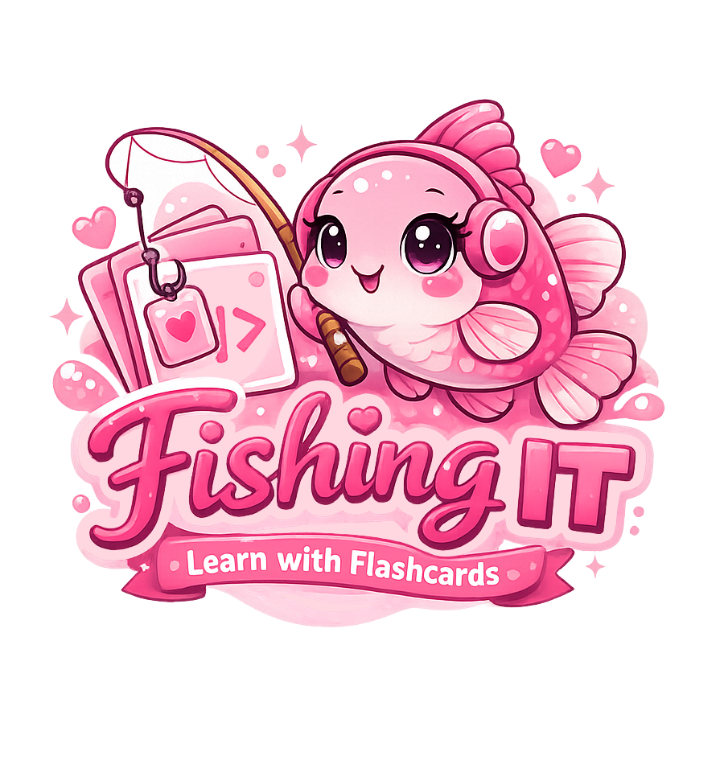
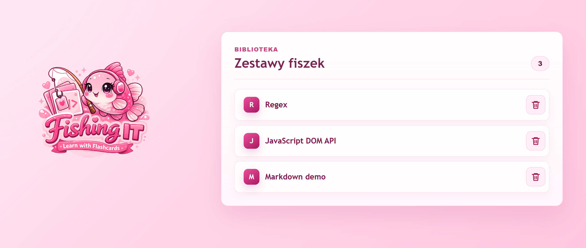
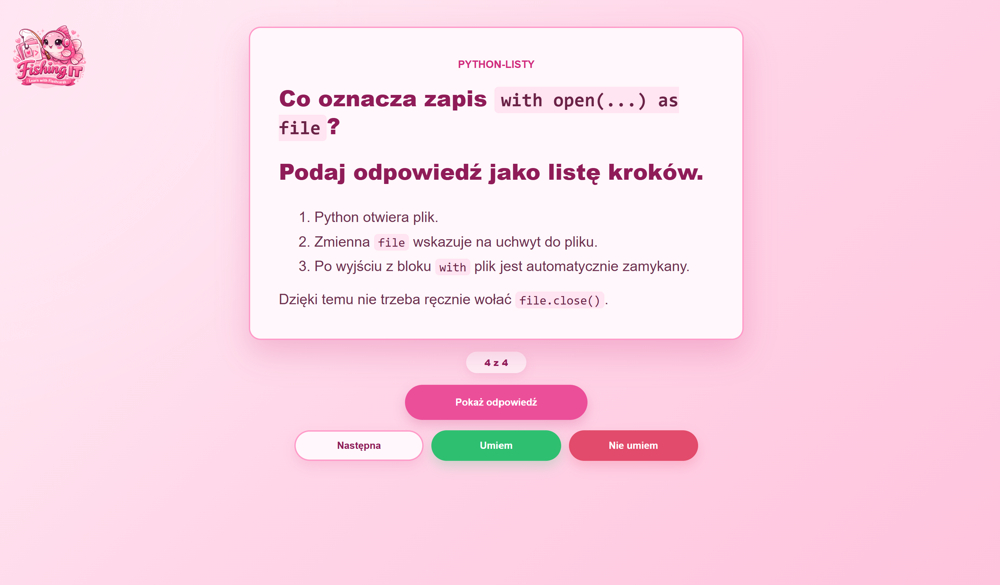
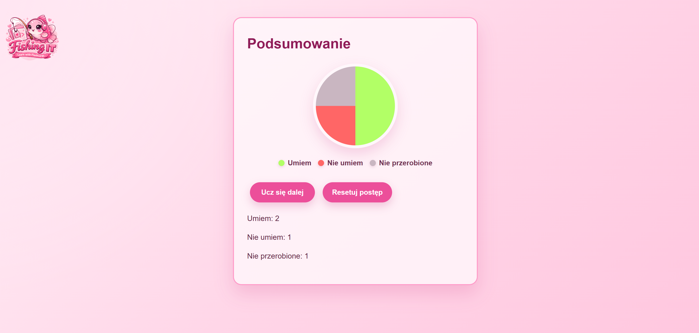
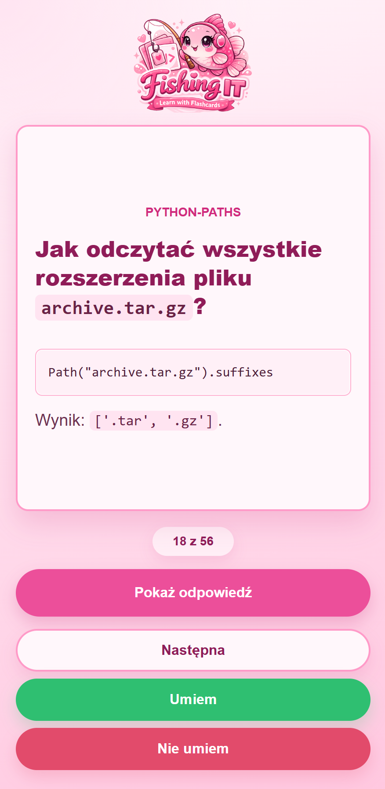

<p align="center">
  
</p>

<p align="center">
  A flashcard app for studying programming concepts.
</p>

<p align="center">
  
  
  
  
</p>

## About

FishingIT is a personal learning project built with Python, Flask, SQLite, and vanilla JavaScript. It brings flashcard decks, self-assessment, and saved study progress together in a simple browser interface.

The interface is currently in Polish. Cards can contain questions and answers in any language, including programming examples formatted with Markdown.

## Features


- Persistent card statuses: `not_started`, `mastered`, and `needs_practice`.
- Study sessions covering either the full deck or cards that have not been mastered.
- Randomized card order using the Fisher-Yates shuffle algorithm.
- On-demand answer reveal, card skipping, and progress reset.
- Progress summaries with status counts and a chart built with CSS.
- Markdown rendering for headings, lists, links, emphasis, inline code, and fenced code blocks.
- Flashcards can currently be added only through the API, either individually or in groups by importing decks from JSON.


## Screenshots

**Deck library - overview of all flashcard decks.**



**Flashcard view - question and revealed answer with Markdown formatting, including numbered lists and inline code.**



**Study summary - progress so far, showing mastered cards, cards needing practice, and cards not yet reviewed.**



**Mobile view - responsive flashcard layout.**




## Local setup

Requirements: **Python 3.13+**, **Node.js 24 (with npm)**, **Git**, and **[uv](https://docs.astral.sh/uv/getting-started/installation/)**.

```bash
git clone https://github.com/magicpaperbox/fishing-it.git
cd fishing-it
uv sync --frozen
npm ci
npm start
```

The development server is available at **http://127.0.0.1:5000**. It runs locally and does not require access to the project's deployment server. The app creates its own `flashcards.sqlite` database on startup; the initial library is empty.

Decks can be populated through `POST /import_flashcards`. Example request body:

```json
{
  "name": "Python basics",
  "flashcards": [
    {
      "category": "Collections",
      "question": "How does a **list** differ from a **tuple**?",
      "answer": "A list is mutable. A tuple is immutable."
    }
  ]
}
```

## Project scope

FishingIT is an ongoing learning project focused on Python backend development, relational data modeling, and frontend–backend communication. The current version uses a shared deck library and study progress, without separate user accounts.
